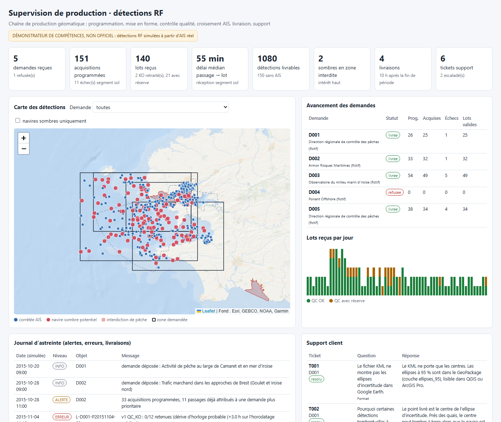
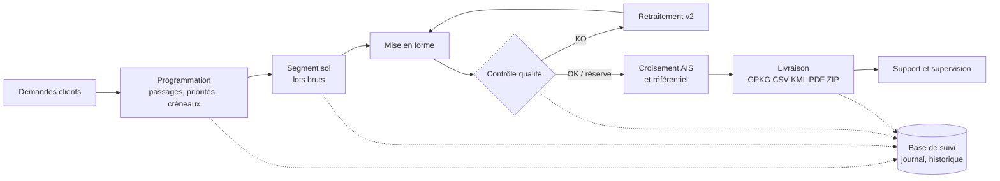
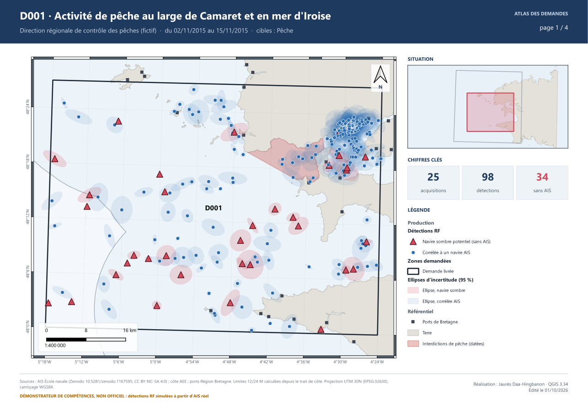
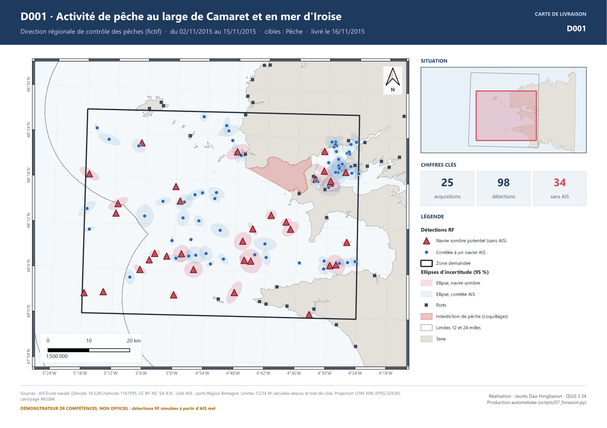
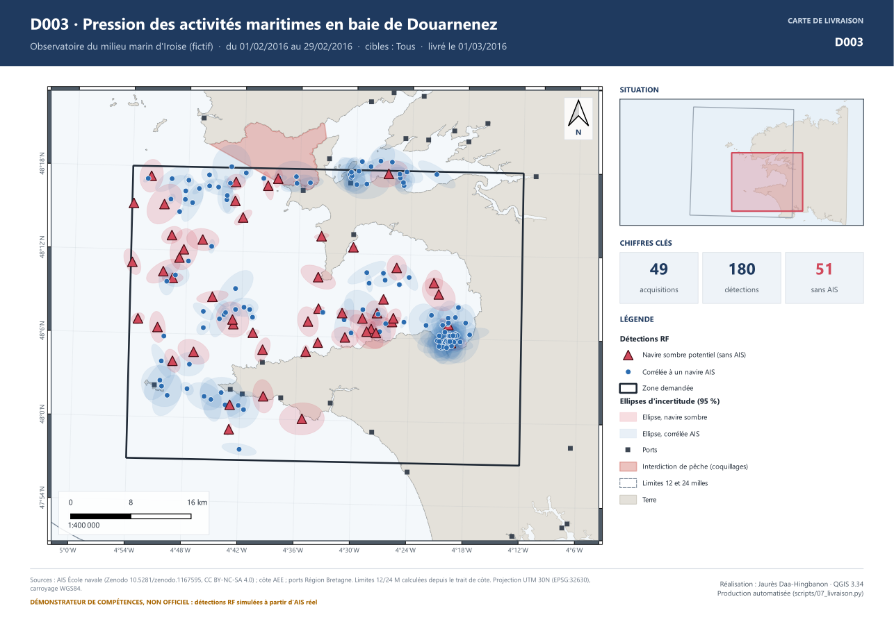

# Chaîne de production de détections RF maritimes : démonstrateur

**Tableau de bord en ligne : https://jauresmas.github.io/surveillance-maritime-rf/**

Atlas des demandes (PDF) : [sorties/atlas_demandes.pdf](sorties/atlas_demandes.pdf) · Rapports de contrôle qualité : [sorties/rapports_qc/index.html](https://jauresmas.github.io/surveillance-maritime-rf/sorties/rapports_qc/index.html)

> Démonstrateur de compétences, non officiel. La constellation (« SIM-01 » à « SIM-12 »), les clients et leurs demandes sont fictifs. Les détections radiofréquence sont **simulées** à partir de données AIS réelles.

Ce projet reproduit le travail d'un technicien géomatique en production de données satellitaires de surveillance maritime : déposer et suivre les demandes de programmation, mettre en forme les données collectées, les contrôler, les croiser avec d'autres sources géographiques, les livrer aux clients et assurer le support et l'astreinte.

[](https://jauresmas.github.io/surveillance-maritime-rf/)

## Ce que fait la chaîne

| Étape | Script | Mission du poste | Produit |
|---|---|---|---|
| 1 | `01_preparation.py` | Manipuler l'information géographique | Référentiel (côte, mer territoriale 12 M, zone contiguë 24 M, ports, interdictions de pêche datées), AIS nettoyé (4,3 M positions), identité de 2 179 navires croisée avec le registre ANFR |
| 2 | `02_demandes_programmation.py` | Déposer et suivre les demandes de programmation | 5 demandes clients, contrôle de recevabilité (1 refus hors zone), catalogue de 1 098 passages, programmation par priorité avec créneaux horaires et arbitrage des conflits |
| 3 | `03_acquisitions.py` + `simulateur.py` | Suivre la génération des données par les satellites et le segment sol | 140 lots bruts au format capteur, 11 échecs d'acquisition, défauts réalistes (doublons, coordonnées vides, fausses alarmes) et 2 lots gravement corrompus |
| 4 | `04_mise_en_forme.py` | Mettre en forme les données collectées | Schéma normalisé, types, unités, géoréférencement WGS84 |
| 5 | `05_controle_qualite.py` | Classer les informations, contrôle qualité | 8 contrôles ligne à ligne, diagnostic de lot, retraitement automatique des lots KO, rapport HTML par lot et synthèse |
| 6 | `06_croisement.py` | Croiser les sources de données géographiques | Corrélation RF / AIS (Mahalanobis + algorithme hongrois + cohérence de signature), enrichissement zones maritimes, interdictions, distance côte, port le plus proche |
| 7 | `07_livraison.py` + `carte_pdf.py` | Livrer aux clients | Par demande : GeoPackage, CSV, KML, carte PDF (mise en page QGIS), bordereau, SHA-256, archive ZIP |
| 8 | `08_supervision.py` | Support de premier niveau, astreintes | Tickets clients (résolus ou escaladés), indicateurs, tableau de bord HTML |
| 9 | `09_export_postgis.py` | (optionnel) | Publication dans PostGIS : tables, ellipses calculées en base, vue matérialisée |
| 10 | `10_projet_qgis.py` | Maîtrise d'un SIG (QGIS) | Projet `surveillance_maritime_rf.qgz` : couches stylées, tables de suivi, animation temporelle, atlas des demandes |

Toutes les étapes écrivent dans une **base de suivi** (`production.sqlite`) : demandes, passages, programmations, lots, livraisons, tickets, journal. Des déclencheurs SQL historisent chaque changement de statut, ce qui permet de retracer le cycle de vie complet d'un lot :

```
L-D001-P20151104-03 : recu → mis_en_forme → qc_ko (dérive d'horloge +3,0 h) → retraitement v2 → qc_ok → correle → livre
```



## Principe de la simulation

Le jeu AIS de l'École navale (Brest, octobre 2015 à mars 2016) sert de **vérité terrain**. À chaque passage programmé :

- la position de chaque navire est interpolée à l'instant exact de chaque détection ;
- chaque navire émet en radiofréquence avec une probabilité qui dépend de son type et de son activité (un navire à quai a souvent son radar éteint) ;
- certains navires coupent leur AIS autour du passage, plus souvent les pêcheurs, et beaucoup plus souvent dans une zone d'interdiction de pêche en vigueur ;
- quelques émetteurs n'ont pas d'AIS du tout ;
- la position mesurée est entachée d'une erreur elliptique (ellipse à 95 % de 0,4 à 3 km).

La vérité (quel navire derrière quelle détection) est stockée à part et **n'est jamais livrée**. Elle sert uniquement à mesurer la qualité de la corrélation.

## Résultats

| Indicateur | Valeur |
|---|---|
| Acquisitions programmées / exploitées | 151 / 140 |
| Lots KO détectés et retraités | 2 (dérive d'horloge, colonnes lat/lon inversées) |
| Lignes brutes / détections retenues après QC | 1 410 / 1 080 |
| Détections corrélées à l'AIS / navires sombres potentiels | 930 / 150 |
| Délai médian passage → réception du lot | 55 min |
| Livraisons | 4 (1 demande refusée) |

**Évaluation honnête de la corrélation** (contre la vérité de simulation) :

- identification du bon navire : **96 % au large**, 51 % à moins de 2 km de la côte, où plusieurs navires à quai tiennent dans une même ellipse kilométrique ;
- navires sans AIS retrouvés : rappel 72 %, précision 86 %.

Les erreurs se concentrent dans les ports. Pistes d'amélioration : exploiter le statut de navigation AIS (« amarré ») et la continuité des trajectoires d'un passage à l'autre.

## Projet QGIS

Ouvrir `surveillance_maritime_rf.qgz` (QGIS 3.34 ou plus, chemins relatifs) :

- **Production** : détections RF (navires sombres en triangles rouges, noms des navires au-delà du 1:60 000), ellipses d'incertitude, zones demandées, navires AIS sans détection RF ;
- **Référentiel** : ports, terre, interdictions de pêche datées, couverture du récepteur AIS, mer territoriale et zone contiguë ;
- **Suivi de production** : tables demandes, programmations, passages, lots, livraisons, tickets, journal, historique des statuts et vue d'avancement, ouvertes directement depuis la base ;
- **Contrôleur temporel** : les détections s'animent passage après passage (Vue, Panneaux, Contrôleur temporel) ;
- **Mise en page « Atlas des demandes »** : une page par demande livrée (carte filtrée sur la demande, carroyage WGS84, flèche du nord, échelles graphique et numérique, carte de situation, chiffres clés), exportée dans `sorties/atlas_demandes.pdf`.



## Livrables

| | |
|---|---|
|  |  |
| D001 : activité de pêche, mer d'Iroise | D003 : baie de Douarnenez, février 2016 |

Chaque livraison (`sorties/livraisons/<demande>_<date>.zip`) contient le GeoPackage (détections, ellipses à 95 %, zone demandée), le CSV, le KML, la carte PDF, la liste des acquisitions, un bordereau HTML et le fichier `SHA256SUMS.txt`.

Documentation d'exploitation : [procédure d'astreinte](docs/procedure_astreinte.md), [FAQ support](docs/faq_support.md). Rapports de contrôle qualité : `sorties/rapports_qc/index.html`.

## Lancer la chaîne

Prérequis : QGIS 3.34 (Python avec geopandas, scipy, PyQGIS). Données : jeu Zenodo [10.5281/zenodo.1167595](https://doi.org/10.5281/zenodo.1167595), archives à décompresser dans `donnees/brutes/` (AIS Data, AIS Status Codes and Types, Brest Receiver, Ports of Brittany, Fishing Constraints, ANFR Vessel List, European Coastline).

```bash
"C:\Program Files\QGIS 3.34.12\bin\python-qgis-ltr.bat" scripts/run_chaine.py
```

Compter une dizaine de minutes. La simulation est reproductible (graine fixe). En cas d'erreur, l'étape fautive est inscrite au journal ; reprendre avec `--depuis 05` par exemple.

Export PostGIS optionnel (connexion par les variables `PGHOST`, `PGDATABASE`, `PGUSER`, `PGPASSWORD`) :

```bash
"C:\Program Files\QGIS 3.34.12\bin\python-qgis-ltr.bat" scripts/09_export_postgis.py
```

## Organisation

```
scripts/           chaîne de production (01 à 09), modules communs, schémas SQL
docs/              procédure d'astreinte, FAQ support
donnees/produites/ référentiel, base de suivi, lots bruts, détections corrélées, vérité de simulation
sorties/           livraisons, rapports QC, tableau de bord, captures
```

## Sources et licences

- AIS, registre ANFR, contraintes de pêche, couverture du récepteur : Ray C., Dréo R., Camossi E., Jousselme A.-L., Iphar C. (2018), *Heterogeneous Integrated Dataset for Maritime Intelligence, Surveillance, and Reconnaissance*, Zenodo, licence CC BY-NC-SA 4.0.
- Trait de côte : Agence européenne pour l'environnement (EEA coastline for analysis).
- Ports : Région Bretagne, Licence ouverte.
- Fond du tableau de bord : Esri World Ocean Base.

Les limites 12 et 24 milles sont calculées depuis le trait de côte, sans les lignes de base droites officielles : c'est une approximation adaptée à la démonstration.

Projet réalisé par Jaurès Daa-Hingbanon, ingénieur géomaticien.
